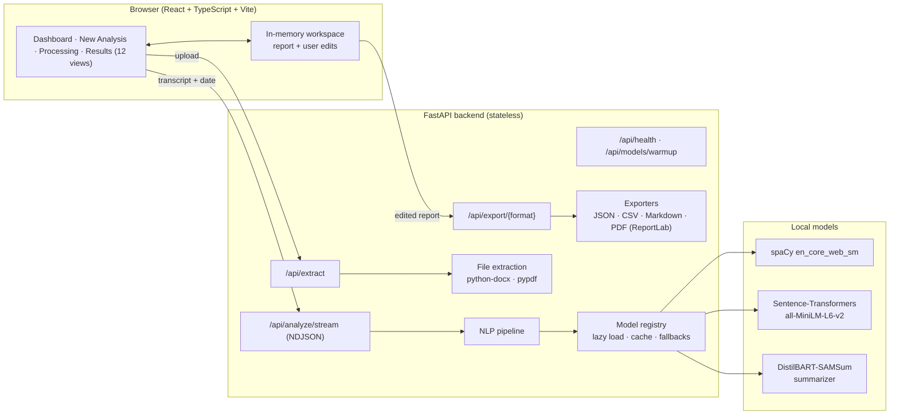
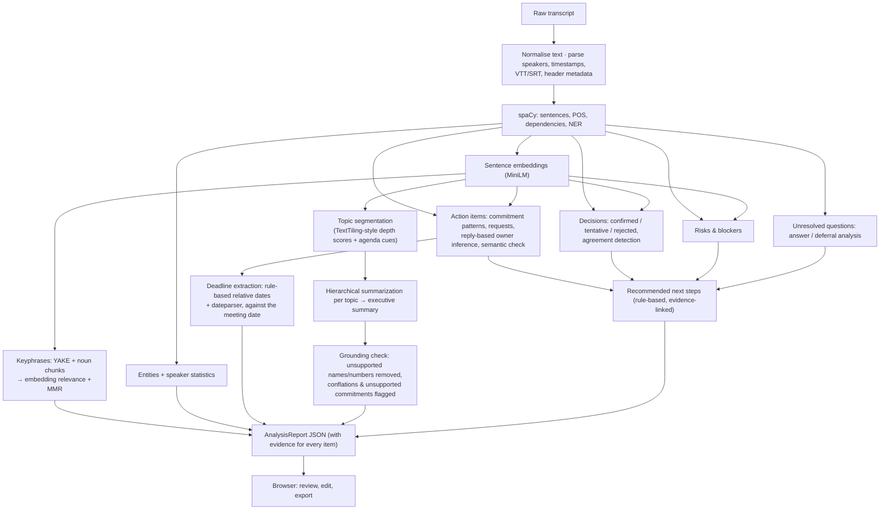

# MeetingMind

**Your meetings, made meaningful.**

MeetingMind is an NLP-based meeting intelligence platform. Paste a meeting transcript or upload a TXT, DOCX, PDF or caption (VTT/SRT) file, and it produces an evidence-backed report: executive and detailed summaries, discussion topics, decisions, action items with owners and deadlines, risks and blockers, unresolved questions, people and named entities, keywords and recommended next steps. Every extracted item links back to the transcript sentences it came from, and anything uncertain is flagged for human review.

It is a complete, runnable application: a React + TypeScript frontend, a FastAPI backend running a local NLP pipeline (spaCy, Sentence-Transformers, Hugging Face Transformers, YAKE, dateparser, scikit-learn), a Google Colab notebook, automated tests and a small manually labelled evaluation set.

---

## Contents

1. [Abstract](#1-abstract)
2. [Problem statement](#2-problem-statement)
3. [Objectives and scope](#3-objectives-and-scope)
4. [Architecture and data flow](#4-architecture-and-data-flow)
5. [NLP techniques](#5-nlp-techniques)
6. [Technology stack](#6-technology-stack)
7. [Installation and running](#7-installation-and-running)
8. [Using the application](#8-using-the-application)
9. [API](#9-api)
10. [Google Colab](#10-google-colab)
11. [Testing and evaluation](#11-testing-and-evaluation)
12. [Privacy](#12-privacy)
13. [Limitations](#13-limitations)
14. [Future enhancements](#14-future-enhancements)
15. [Project structure](#15-project-structure)

More documents are in [docs/](docs/): [architecture](docs/ARCHITECTURE.md), [NLP techniques in detail](docs/NLP_TECHNIQUES.md), [API reference](docs/API.md), [evaluation](docs/EVALUATION.md), [demonstration script](docs/DEMO_SCRIPT.md) and [viva questions and answers](docs/VIVA_QA.md). A sample transcript and its real output are in [samples/](samples/).

---

## 1. Abstract

Meetings produce decisions and commitments that are easy to lose in long transcripts. MeetingMind converts unstructured, multi-speaker transcripts into structured meeting intelligence using a hybrid pipeline. Linguistic analysis (spaCy tokenisation, part-of-speech tagging, dependency parsing and named-entity recognition) finds commitment, decision and risk cues. Sentence embeddings (all-MiniLM-L6-v2) provide semantic checks, topic segmentation, keyphrase re-ranking and de-duplication. A dialogue-tuned DistilBART model produces hierarchical abstractive summaries, which are then verified against the transcript. Relative deadlines are normalised against the meeting date with explicit, documented rules. On a small held-out set of three transcripts written after development finished, the system reached a micro-F1 of 0.76, against 0.53 for a keyword baseline. Owners and deadlines were 100% correct on the action items it found.

## 2. Problem statement

Transcripts from Zoom, Teams or manual notes are long, informal and spread across speakers. "Can you send that by Friday?" only becomes an action item when you know who "you" is (often the next speaker who says "Sure") and which Friday is meant. Generic summarizers skip these details or invent them. Teams need a tool that:

- extracts *who* will do *what* by *when*, without inventing owners or dates;
- separates real decisions from suggestions and hypotheticals;
- surfaces risks, blockers and questions nobody answered;
- shows the exact evidence for every claim, so people can trust or correct it.

## 3. Objectives and scope

**Objectives**

- Build a real NLP pipeline that works on arbitrary user transcripts, not just the sample.
- Ground every important output in transcript evidence and mark inferred or uncertain items.
- Provide a polished web app for reviewing and editing results, with JSON, CSV, Markdown and PDF exports that include the user's edits.
- Measure quality on a manually labelled dataset, with precision, recall and F1.

**In scope:** English transcripts as text; TXT/DOCX/text-based PDF/VTT/SRT upload; single-user, local deployment; CPU-friendly models.

**Out of scope:** audio transcription (speech-to-text), OCR of scanned PDFs, accounts or multi-user collaboration, persistent storage, and languages other than English.

## 4. Architecture and data flow





The **Processing** page shows real progress. The backend streams newline-delimited JSON events as each of the 11 pipeline stages actually starts, reports progress (for example "Summarising topic 2 of 4") and completes. Nothing is simulated. See [docs/ARCHITECTURE.md](docs/ARCHITECTURE.md) for module-level details.

## 5. NLP techniques

| Task | Technique |
|---|---|
| Transcript parsing | Regex grammar for `Name: text`, `[hh:mm:ss] Name:`, `Name (mm:ss):`, Otter/Teams headers, WebVTT `<v Name>` and SRT; header metadata (title, date, attendees) separated from speech |
| Sentence segmentation, POS, dependencies, NER | spaCy `en_core_web_sm` |
| Action items | Linguistic patterns over the spaCy parse (self-commitments, named commitments, requests with vocatives, "who's taking…?", `Action:` lines, imperatives, clause splitting with pronoun antecedents). Then a **nearest-prototype semantic check** with Sentence-Transformers, **owner inference from replies** ("Sure, I'll take that"), merging of acceptances into requests, and embedding-based de-duplication |
| Deadlines | Deterministic rules for relative expressions (next Friday, EOD, end of quarter, in two weeks…) resolved against the meeting date, and `dateparser` for explicit dates. Ambiguity is flagged, and vague timing is never converted into a date |
| Decisions | Cue lexicons for confirmed, tentative, conditional and rejected decisions; filters for suggestions, hypotheticals and questions; tag-question handling ("…, right?" + "Correct"); proposal-plus-agreement detection; semantic veto for weak plan statements |
| Risks & blockers | Problem and dependency lexicon, structural filters (commitments, suggestions, recaps, anaphora), semantic veto, heuristic severity |
| Unresolved questions | Question detection, filler filtering, reply analysis (answered, deferred, hedged, topic change), explicit open-issue statements with referent lookup |
| Topics | TextTiling-style segmentation over sentence embeddings, boosted by agenda-transition phrases; topic labels from keyphrases; key points by TextRank centrality |
| Keywords | YAKE candidates restricted to spaCy noun phrases, re-ranked KeyBERT-style by embedding similarity to the document, with Maximal Marginal Relevance |
| Summaries | `philschmid/distilbart-cnn-12-6-samsum` (dialogue summarization) applied per topic, with token-aware chunking and map-reduce for long transcripts; the executive summary is generated from the topic summaries; an extractive TextRank fallback |
| Hallucination control | Generated sentences whose names or numbers are absent from the transcript are removed. Sentences that combine facts from distant lines, or claim a commitment with no matching action item, are marked "weakly supported" |

"Signal" labels (strong, moderate, weak) describe how strongly the wording and the semantic check agree. They are heuristic labels, **not calibrated probabilities**, and the UI says so. Full explanations are in [docs/NLP_TECHNIQUES.md](docs/NLP_TECHNIQUES.md).

## 6. Technology stack

| Layer | Technology |
|---|---|
| Frontend | React 19, TypeScript 5.9, Vite 8, Tailwind CSS 4, React Router 7, Lucide icons, Recharts 3, self-hosted Inter and Instrument Serif fonts |
| Backend | Python 3.10+ (developed on 3.14), FastAPI, Pydantic 2, Uvicorn |
| NLP / ML | PyTorch, Hugging Face Transformers (v4 and v5 supported), Sentence-Transformers, spaCy, YAKE, dateparser, scikit-learn, NumPy |
| Files & exports | python-docx, pypdf, ReportLab |
| Testing | pytest + FastAPI TestClient, Vitest + Testing Library (jsdom) |
| Notebook | Google Colab + Gradio |

**Models** (downloaded automatically on first use, about 1.3 GB in total):

| Model | Size | Role |
|---|---|---|
| `en_core_web_sm` | 12 MB | parsing and NER |
| `sentence-transformers/all-MiniLM-L6-v2` | 90 MB | embeddings |
| `philschmid/distilbart-cnn-12-6-samsum` | 1.2 GB | abstractive summarization; low-memory alternative: `lidiya/bart-base-samsum` (560 MB) |

All are free, run locally on a laptop CPU, and need no API keys.

## 7. Installation and running

**Requirements:** Python 3.10 or newer, Node.js 20 or newer, about 3 GB of free disk space, and internet access for the first model download.

### Quick start

Windows (PowerShell, from the project folder):

```powershell
powershell -ExecutionPolicy Bypass -File scripts\setup.ps1     # one-time: venv, Python packages, spaCy model, npm install
powershell -ExecutionPolicy Bypass -File scripts\start-backend.ps1    # terminal 1 → http://127.0.0.1:8000
powershell -ExecutionPolicy Bypass -File scripts\start-frontend.ps1   # terminal 2 → http://localhost:5173
```

macOS / Linux:

```bash
bash scripts/setup.sh
bash scripts/start-backend.sh      # terminal 1
bash scripts/start-frontend.sh     # terminal 2
```

Open **http://localhost:5173**. The first analysis loads the models; the very first run also downloads them, which can take several minutes.

### Manual setup

```bash
python -m venv .venv
# Windows: .venv\Scripts\activate      macOS/Linux: source .venv/bin/activate
pip install torch --index-url https://download.pytorch.org/whl/cpu   # CPU build; skip if torch is installed
pip install -r backend/requirements-dev.txt
python -m spacy download en_core_web_sm

cd backend
uvicorn app.main:app --host 127.0.0.1 --port 8000

# in another terminal
cd frontend
npm install
npm run dev
```

Production build of the frontend: `cd frontend && npm run build` (output in `frontend/dist`). Serve it with `npm run preview`, or with any static server that proxies `/api` to the backend.

### Configuration

The backend reads environment variables, or `backend/.env` (copy [backend/.env.example](backend/.env.example)):

| Variable | Default | Purpose |
|---|---|---|
| `MEETINGMIND_SUMMARY_MODE` | `abstractive` | `extractive` skips the summarization model (fast, low memory) |
| `MEETINGMIND_SUMMARIZER_MODEL` | `philschmid/distilbart-cnn-12-6-samsum` | any seq2seq summarization model |
| `MEETINGMIND_EMBEDDING_MODEL` | `sentence-transformers/all-MiniLM-L6-v2` | sentence-embedding model |
| `MEETINGMIND_SPACY_MODEL` | `en_core_web_sm` | e.g. `en_core_web_md` for better NER |
| `MEETINGMIND_PRELOAD_MODELS` | `false` | load models at startup instead of on the first analysis |
| `MEETINGMIND_DEVICE` | `auto` | `cpu`, `cuda` or `auto` |
| `MEETINGMIND_MAX_UPLOAD_MB` | `10` | upload size limit |
| `MEETINGMIND_MAX_TRANSCRIPT_CHARS` | `300000` | transcript length limit |
| `MEETINGMIND_MIN_TRANSCRIPT_WORDS` | `15` | minimum transcript length |
| `MEETINGMIND_CORS_ORIGINS` | `http://localhost:5173,http://127.0.0.1:5173` | allowed browser origins when not using the dev proxy |

The frontend reads `VITE_API_BASE_URL` (empty means using the dev proxy) and `MEETINGMIND_API_PROXY` (see [frontend/.env.example](frontend/.env.example)).

## 8. Using the application

1. **Dashboard:** overview, feature list, privacy notes, and **Try the sample transcript**.
2. **New analysis:** title, meeting date (used to resolve "next Friday"), optional context, and a transcript editor with word and speaker-line counts. Drag in a TXT, DOCX, PDF, VTT or SRT file; the extracted text appears in the editor for review. **Clear** resets the form; **Analyze meeting** starts the analysis.
3. **Processing:** live stage-by-stage progress from the server, with a notice while models initialise, error messages with *Try again*, and *Cancel*.
4. **Results:** twelve views: Overview, Executive summary, Discussion topics, Decisions, Action items, Deadlines, Risks & blockers, Unresolved questions, People & entities, Keywords, Transcript evidence and Recommended next steps.
5. **Action items:** inline editing of description, owner, deadline, status and priority; search, filters (status, owner, needs review), sorting, *Mark reviewed*, add and delete. Every edit updates the in-memory report, so all exports reflect it.
6. **Export:** PDF meeting minutes, a Markdown report, CSV action items or full JSON, all generated from the current, edited report.

Transcripts work best with one speaker turn per line (`Priya: I'll send it by Friday.`). Without speaker labels, owners can only come from names mentioned in the text, and the report says so.

## 9. API

Interactive documentation is served at **http://127.0.0.1:8000/docs** (OpenAPI). Summary:

| Method | Path | Purpose |
|---|---|---|
| GET | `/api/health` | status, version, summary mode and each model's state (`not_loaded`, `loading`, `ready`, `failed`, `disabled`) |
| POST | `/api/models/warmup` | load all models now; also retries models that failed earlier |
| POST | `/api/extract` | multipart `file` → `{filename, file_type, text, word_count, char_count, pages, warnings}` |
| POST | `/api/analyze` | `{transcript, title, meeting_date, context}` → `AnalysisReport` |
| POST | `/api/analyze/stream` | same input; NDJSON events `accepted`, `queued`, `stage` (started/progress/completed/failed), then `result` or `error` |
| POST | `/api/export/{json,csv,markdown,pdf}` | body: an `AnalysisReport`, possibly edited → file download |

Errors return `{"detail": "…"}` with 400, 413, 415, 422 or 500. Validation errors never echo the submitted transcript. The full schema and examples are in [docs/API.md](docs/API.md).

## 10. Google Colab

[notebooks/MeetingMind_Colab.ipynb](notebooks/MeetingMind_Colab.ipynb) runs the same backend pipeline:

1. Open the notebook in Colab (*File → Upload notebook*). A GPU runtime is optional.
2. Run **Step 1** and upload `MeetingMind.zip` when prompted, or set `REPO_URL` to a Git repository that contains the project.
3. Run Steps 2–3 to install requirements and load the models.
4. Step 5 analyses the sample transcript. Step 6 analyses your own text or an uploaded TXT/DOCX/PDF and downloads JSON, CSV, Markdown and PDF. Step 7 opens a **Gradio** interface (with `share=True`, Gradio creates a temporary public link).

The notebook was executed end-to-end outside Colab with `nbclient` (Colab-only upload and download calls are skipped there). It has not been run on a live Colab runtime as part of this build.

## 11. Testing and evaluation

```bash
cd backend && python -m pytest                # 112 tests; add -m "not slow" to skip loading the 1.2 GB summarizer
cd backend && python -m evaluation.evaluate   # precision / recall / F1 on the labelled set
cd frontend && npm test                        # 15 component tests (Vitest + jsdom)
cd frontend && npx tsc -b                      # type check
```

Or run everything with `scripts/run-tests.ps1` / `scripts/run-tests.sh`.

**Backend tests (112, all passing)** cover: empty, short, too-long and non-text input; malformed dates and missing fields; TXT (UTF-8 and UTF-16), DOCX and PDF uploads; unsupported, legacy `.doc`, fake, binary, scanned-PDF, empty and oversized files; temporary-file cleanup; speaker formats (bracketed timestamps, Otter, WebVTT, SRT, markdown bold, unlabelled text); multiple speakers; self, named, addressed, reply-inferred and unassigned owners; explicit, relative, ambiguous, vague and missing-meeting-date deadlines; decisions versus suggestions, hypotheticals and questions; agreements and conditional decisions; risks and blockers; answered, deferred and unanswered questions; evidence integrity; model-loading failures and fallbacks; long transcripts with hierarchical chunking; summary grounding; real abstractive summarization; streaming stage order; all four exports; user edits reflected in every export; and CSV formula-injection protection.

**Frontend tests (15)** render all 12 result views, check that action-item edits update the report used for exports, and test the processing page's result handoff and error display.

**End-to-end check (manual, scripted with Chrome):** the dashboard, DOCX upload, sample analysis with live stages (35 s on CPU, with models cached), every results view, editing, all four downloads (with edits confirmed in the CSV and Markdown files), the evidence jump, and phone-width layouts with no horizontal overflow.

### Evaluation results

The labelled dataset has 10 transcripts and 125 gold items, labelled by the project author following written guidelines in [backend/evaluation/labels.json](backend/evaluation/labels.json). Items are matched by evidence sentence. The baseline flags every sentence that contains a cue word.

| Split | Purpose | System micro-F1 | Baseline micro-F1 |
|---|---|---|---|
| dev (3 transcripts) | used while developing the rules | 0.88 | 0.65 |
| test v1 (4) — frozen first run | held out, evaluated before any changes | **0.66** | 0.61 |
| test (4) — after error analysis | post-hoc, *not* a fair estimate | 0.96 | 0.61 |
| **holdout-2 (3)** — written after all changes, run once | best estimate of generalisation | **0.76** | 0.53 |

On holdout-2: action items F1 0.86, decisions 0.67 (recall 0.50), risks 0.53 (recall 0.40) and questions 1.00. Owner and deadline accuracy were 100% on matched items. Precision is consistently higher than recall: the system misses items more often than it invents them, which is the intended trade-off. With 3–4 transcripts per split, these figures carry large uncertainty. See [docs/EVALUATION.md](docs/EVALUATION.md) and [backend/evaluation/RESULTS.md](backend/evaluation/RESULTS.md).

## 12. Privacy

- No database, accounts, cookies or meeting history; the API is stateless.
- Uploaded files are written to a private temporary directory only during text extraction and are deleted afterwards, even on errors.
- Transcript text is never written to logs; logs record only sizes, counts and timings. Validation errors do not echo the request body.
- Reports live only in the browser tab's memory (not in localStorage). The app warns before you close the tab and asks for confirmation before discarding a report, so you can export first.
- All models run locally; no paid or third-party AI APIs are called. Fonts are bundled, not loaded from Google.

**Limitations of these guarantees:** whoever operates the backend can modify it to log data. The first run downloads model files from Hugging Face, but no transcript data is sent. The Gradio `share=True` link in Colab is reachable by anyone who has it while the runtime is running. Exported files are ordinary files you are responsible for.

## 13. Limitations

- **Rule coverage.** Decision and risk recall on unseen transcripts is the weakest area (0.50 and 0.40 on holdout-2), because unusual phrasings fall outside the cue lexicons. The semantic prototype check helps precision more than recall.
- **Small evaluation set.** It was labelled by one person, with no inter-annotator agreement.
- **Abstractive summaries** can still merge or misattribute details. The grounding checks remove or flag many of these (for example "Android 9 was moved to March 17" and "Cara is going to write the announcement"), but not all: a sentence pairing two people mentioned in adjacent lines can pass. Each summary sentence shows its evidence for this reason.
- **NER** uses the small spaCy model, so some organisations and products are mislabelled. Generic acronyms such as SDK and FAQ are filtered out.
- **Pronoun resolution** ("he will…") is not attempted; such items are left unassigned and flagged.
- **Speaker labels:** without `Name:` labels, self-commitments ("I'll…") cannot get an owner.
- **Performance:** CPU analysis of a 650-word transcript takes about 25–40 s, mostly summarization; long transcripts take minutes. One analysis runs at a time and others queue.
- **English only.** Scanned PDFs are not supported (no OCR), and neither is audio.
- **The Colab notebook** was verified outside Colab, not on a live Colab runtime.

## 14. Future enhancements

- Train a lightweight classifier (for example logistic regression or a fine-tuned MiniLM) on a larger labelled corpus such as AMI or ICSI meeting annotations, to raise decision and risk recall.
- Coreference resolution for pronoun owners; a transformer NER model as an option.
- Speech-to-text (for example Whisper) for audio uploads, with diarisation.
- Natural-language inference (NLI) checks for summary faithfulness.
- Calendar (.ics) export of deadlines, and integrations with task trackers.
- Optional encrypted storage of reports for teams that want history.

## 15. Project structure

```
MeetingMind/
├─ backend/
│  ├─ app/
│  │  ├─ main.py               FastAPI app factory, CORS, error handling
│  │  ├─ config.py             environment-based settings
│  │  ├─ schemas.py            Pydantic API contract (AnalysisReport, …)
│  │  ├─ api/routes.py         endpoints (health, extract, analyze, stream, export)
│  │  ├─ nlp/                  preprocessing, models, actions, deadlines, decisions,
│  │  │                        risks, questions, entities, keywords, topics,
│  │  │                        summarizer, next_steps, pipeline
│  │  └─ services/             file_extraction.py, exports.py
│  ├─ tests/                   pytest suite (112 tests)
│  ├─ evaluation/              labelled transcripts, labels.json, evaluate.py, RESULTS*.md
│  ├─ requirements.txt / requirements-dev.txt / .env.example
├─ frontend/
│  ├─ src/pages/               Dashboard, NewAnalysis, Processing, Results
│  ├─ src/results/             the 12 report views + charts
│  ├─ src/components/          UI kit, evidence viewer, export menu, dialogs, layout
│  ├─ src/state/workspace.tsx  in-memory report and edit logic
│  ├─ src/api/client.ts        typed API client (NDJSON streaming)
│  └─ src/test/                Vitest tests
├─ notebooks/MeetingMind_Colab.ipynb
├─ samples/                    sample transcript + real outputs (MD, JSON, CSV, PDF)
├─ docs/                       architecture, NLP, API, evaluation, demo script, viva Q&A
└─ scripts/                    setup / start / test scripts (PowerShell and Bash)
```
"# MeetingMind" 
