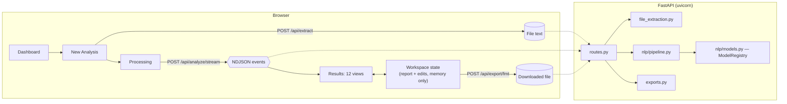
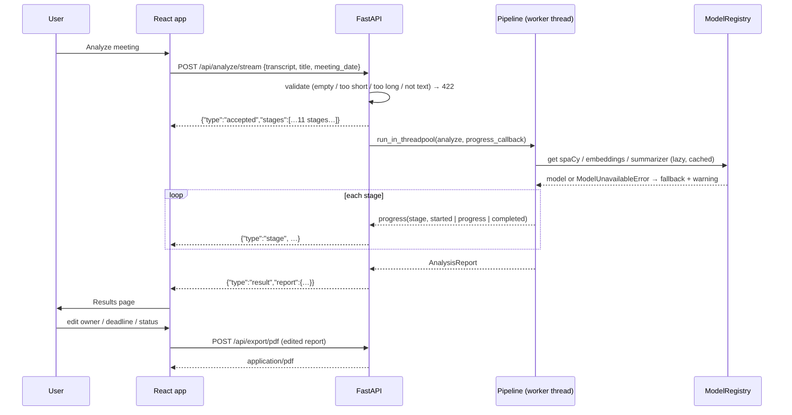

# Architecture

MeetingMind has two parts. A **stateless FastAPI backend** runs the NLP pipeline. A **React single-page app** holds the report in memory, lets the user edit it, and asks the backend to render exports. They talk over a JSON API whose contract is defined once, in [backend/app/schemas.py](../backend/app/schemas.py), and mirrored in [frontend/src/types.ts](../frontend/src/types.ts).

## System diagram

## Analysis data flow

## Backend modules

| Module | Responsibility |
|---|---|
| `app/main.py` | App factory: CORS, body-size middleware, a validation-error handler that never echoes request bodies, optional model preloading |
| `app/config.py` | `Settings` from environment variables or `backend/.env` |
| `app/schemas.py` | Pydantic models for requests, the report and every item type |
| `app/api/routes.py` | Endpoints. Analyses run in a worker thread behind an `asyncio.Lock` (one at a time; others receive a `queued` event) |
| `app/nlp/models.py` | `ModelRegistry`: lazy, thread-safe loading, load timing, failure capture and retry; the `Seq2SeqSummarizer` wrapper calls `generate()` directly, so it works on Transformers v4 and v5 |
| `app/nlp/preprocessing.py` | Text normalisation, speaker/timestamp grammar, VTT/SRT, metadata headers, utterance merging, spaCy sentence segmentation |
| `app/nlp/common.py` | `Embedder` (with a hashed n-gram fallback), `PrototypeScorer`, `NameResolver`, filler cleaning, evidence helpers |
| `app/nlp/actions.py` | Action-item extraction (see [NLP_TECHNIQUES.md](NLP_TECHNIQUES.md)) |
| `app/nlp/deadlines.py` | Date expression rules and normalisation |
| `app/nlp/decisions.py`, `risks.py`, `questions.py` | The other extractors |
| `app/nlp/entities.py`, `keywords.py`, `topics.py` | NER aggregation and people statistics, keyphrases, topic segmentation |
| `app/nlp/summarizer.py` | Hierarchical summarization and grounding checks |
| `app/nlp/next_steps.py` | Rule-based recommendations linked to evidence |
| `app/nlp/pipeline.py` | Orchestration, stage events, validation, statistics, report assembly |
| `app/services/file_extraction.py` | TXT/DOCX/PDF/VTT/SRT text extraction with temporary-file cleanup and magic-byte checks |
| `app/services/exports.py` | JSON, CSV (formula-injection safe, UTF-8 BOM), Markdown, PDF (ReportLab, Unicode TTF when available) |

## Frontend structure

| Path | Responsibility |
|---|---|
| `src/state/workspace.tsx` | Draft form, current job, report; `updateAction`, `addAction`, `deleteAction` keep the deadline list, statistics and `edited_at` in sync |
| `src/api/client.ts` | Typed fetch wrapper, NDJSON stream reader, export download |
| `src/pages/*` | Dashboard, New Analysis, Processing (StrictMode-safe single stream per job), Results (route `/results/:section`) |
| `src/results/*` | The 12 views; `charts.tsx` holds the two Recharts bar charts |
| `src/components/*` | UI kit (buttons, badges, cards), evidence list (jumps to `/results/evidence?s=<sentence id>`), export menu, confirm dialog, layout with a live model-status pill |

## Robustness and fallbacks

| Failure | Behaviour |
|---|---|
| Summarizer fails to download or load | Extractive TextRank summary; warning shown in the report |
| Embedding model fails | Hashed TF-IDF-style vectors; semantic checks disabled and rules only; warning |
| spaCy model fails | `spacy.blank("en")` with a sentencizer; no NER or parser; speaker labels still provide people; warning |
| Previously failed model | `POST /api/models/warmup` resets failures and retries |
| Scanned or encrypted PDF, legacy `.doc`, binary file | Clear 4xx message |
| Client disconnects mid-analysis | The server finishes the current run and discards it; nothing is stored |
